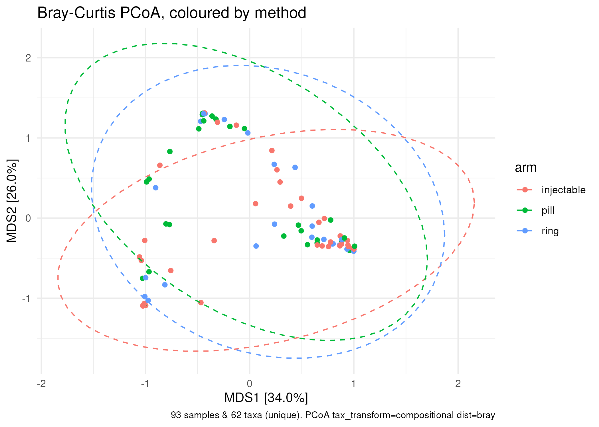
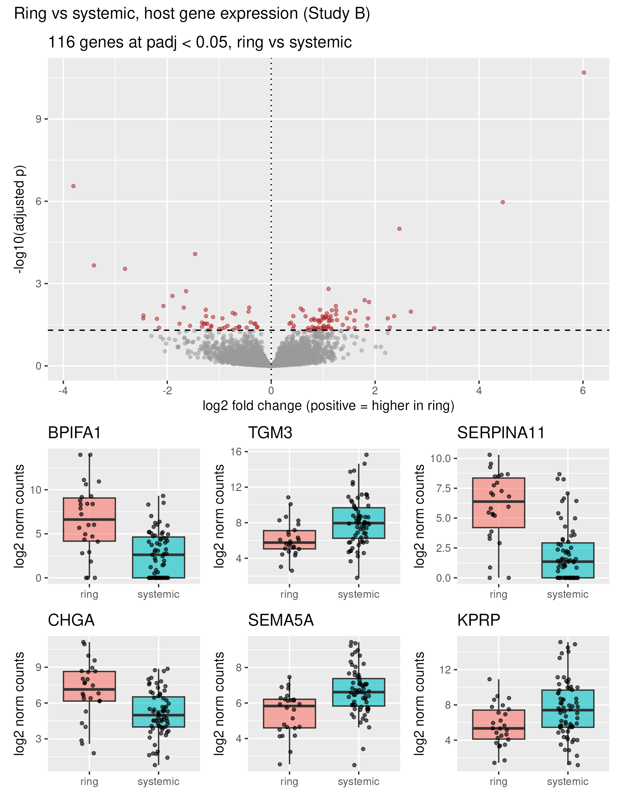

> **STATUS: DRAFT FOR THE TEAM.** Everything in normal text is filled in from
> our pair's three reports and the merged QC document. Everything in a yellow
> **NEEDS YOUR DECISION** box is a question the group must answer before this
> becomes the final report. Delete this status block once all boxes are resolved.

```{r setup}
#| include: false
library(conflicted)
library(tidyverse)
library(here)
conflicts_prefer(dplyr::filter, dplyr::count)
source(here("R/count_tables.R"))
d <- read_counts("group_b")
meta <- d$metadata
```

# 1. The question

::: callout-warning
## NEEDS YOUR DECISION (whole group, NoteT2)

One sentence for the whole talk. Our pair's proposal, based on what the data
can actually answer:

> **In 93 women using three contraceptive methods (injectable, pill, ring),
> does the method relate to vaginal bacterial community composition, and
> does the ring — the only method acting locally at the cervix — relate to
> host gene expression?**

Alternatives the group might prefer: a narrower single question (just the
composition half, or just the gene half) or a BV-centred question. Pick one
and delete the rest.
:::

# 2. What we did, and what we filtered and why

## Quality control (all six reports merged, every claim re-run live)

- **Sample IDs**: identical set *and identical order* across metadata,
  species table, gene table and cytokine table — 93 samples each.
- **Library sizes**: microbiome minimum 5,247 reads (**B006**, the only clean
  outlier; it sits inside the PCoA cloud, so it stays). Gene table minimum
  5.86M reads (**B042**, 45% of the median — not a failure; DESeq2 size
  factors absorb this).
- **Metadata**: zero missing values in all 8 columns. Cytokines: **B018 and
  B029 miss all 15 markers** (consistent with a failed lab plate).
- **Batch**: `rnaseq_batch` is balanced against arm (about 50/50 in every
  arm) — but batch B1 ran deeper than B2 (median 13.7M vs 12.0M reads), so
  balanced is not interchangeable.
- **Baseline balance**: BV leans positive in the injectable arm
  (19/39 vs 10/28 and 10/26); Fisher's exact test p = 0.454 — not
  significant, but the direction is pre-planned and adjusted for anyway.

## Filters and rules (each with the alternative we did not take)

| What | Rule we used | Why | Alternative not taken |
|---|---|---|---|
| Species for ordination/PERMANOVA | present in ≥10 of 93 samples (62 species) | single-sample species add noise to every distance | all-zero-only drop (134 species) |
| Genes for DESeq2 | ≥10 reads in ≥24 of 93 samples (14,226 → 13,713 kept; 13,707 tested) | dispersion can't be estimated for near-empty genes | no filter |
| Samples dropped | none at QC stage; B018/B029 excluded from cytokine analyses only | all-or-nothing missing cytokines, not a sequencing failure | dropping them everywhere |
| Group definition | `arm` from the **metadata**, tested on count tables | never define and test on the same table | deriving groups from a count table |
| Counts into DESeq2 | raw counts, `poscounts` size factors | DESeq2 normalises itself; many zeros break the default estimator | CPM/logged input |

::: callout-warning
## NEEDS YOUR DECISION (whole group, NoteW2)

The group promised one shared QC rule. Open items from the merged QC doc:

1. **Species filter** — our pair used prevalence ≥10 (62 species); the other
   trio's all-zero rule keeps 134. **Pick one for everyone.** We propose
   prevalence ≥10.
2. **Low-read rule** — 10%-of-median (drops nobody) vs visual gap (drops
   B006). Either way B006 stays in our analyses; decide which name to put on
   the slide.
3. **B018/B029** — confirm "drop from cytokine analyses only" if any pair
   analyses cytokines; otherwise note it and move on.
4. **`rnaseq_batch` in DESeq2 designs** — the merged QC doc says yes (B1 ran
   ~2M reads deeper) but our host-gene report left it out because the
   cross-tab was balanced. **This is a real conflict — see §4.** Our
   proposal: re-render the gene analysis with `+ rnaseq_batch` in the design
   and check the 116 genes survive.
:::

# 3. Sub-question 1 — community composition

**What we found:** the three methods do **not** detectably differ in
community composition. Three-way PERMANOVA (Bray–Curtis, adjusted for BV,
pH and STI): arm p = 0.069, R² = 2.8%. The best-powered contrast, ring vs
systemic pooled: p = 0.854 — clearly null. Shannon diversity by arm:
p = 0.47. Dispersion is equal across arms (betadisper p = 0.747), so the
weak signal is not a spread artifact.

**What does differ is BV: R² = 14%, p = 0.001** — five times more variation
than the method. Axis 1 is essentially a BV axis (*Gardnerella*,
*Dialister*, *Prevotella*, *Sneathia*, *Fannyhessea* positive;
*Lactobacillus* strongly negative). Because nobody was randomised and BV is
not evenly distributed across arms, BV is a plausible confounder, not just
a covariate.



::: callout-warning
## NEEDS YOUR DECISION (this pair, NoteT1)

**Choice we made slide.** Our route: Bray–Curtis on relative abundance, with
CLR + Euclidean as a second opinion, `by = "margin"`, seed fixed. The
partner's route: *(fill in — Jaccard? different filter? different model
order?)*. Which do we keep, and why? **And one source one of us actually
opened and read** — our candidate: the microViz ordination guide
(https://microbiome.github.io/microViz/articles/ordination.html). Put the
name of the person who read it.
:::

# 4. Sub-question 2 — host gene expression

**What we found:** **116 genes differ between ring and systemic at adjusted
p < 0.05** (72 higher in ring, 44 lower). Headline gene: **BPIFA1**, a
secreted innate-immunity protein of mucosal epithelium, ~64-fold higher in
the ring (padj = 2×10⁻¹¹); down genes include the epithelial structural
proteins TGM3 and KPRP. The raw-p histogram spikes near zero over a flat
background, so the signal is not mass noise.

**The covariates matter:** the unadjusted design calls 227 genes, the
adjusted one 116 — nearly half the raw list was BV/pH/STI talking (STI is
17/26 in ring vs 31/67 systemic).



::: callout-warning
## NEEDS YOUR DECISION (this pair, NoteT1)

**Batch conflict to settle.** The merged QC document recommends keeping
`rnaseq_batch` in every DESeq2 design (B1 ran deeper); our report left it
out because the batch × group cross-tab was balanced. Two options:

1. Keep the current adjusted model (`~ bv + ph + any_sti + systemic`) and
   argue balance makes batch unnecessary — cite the cross-tab.
2. Re-render with `~ bv + ph + any_sti + rnaseq_batch + systemic` and
   report whether the 116 genes hold. *(Our recommendation — it costs one
   degree of freedom and pre-empts the audience's obvious question.)*

Say which, and we add the re-run here. Source to have actually read:
the DESeq2 paper (Love, Huber & Anders 2014, Genome Biology) — at least the
size-factor and design sections.
:::

# 5. The answer, as plainly as the data allow

::: callout-warning
## NEEDS YOUR DECISION (whole group, NoteT2 — final wording)

Draft, based on what the data support:

> **Contraceptive method showed no detectable association with vaginal
> bacterial community composition (p = 0.07 three-way; p = 0.85 ring vs
> systemic), and we can rule out only a *large* method effect with 93
> women. Bacterial vaginosis, not the method, dominated composition
> (R² = 14%, p = 0.001). Host gene expression did differ between ring and
> systemic users (116 genes, adjusted p < 0.05), led by the epithelial
> innate-immunity protein BPIFA1 — consistent with a local effect of the
> ring on cervical tissue, though the comparison is observational.**
:::

# 6. What we do not believe about our own result

*(Required section. Draft below; the group edits, keeps, adds.)*

- **BV could be the whole story.** It explains 14% of composition variation
  and its prevalence differs across arms. If BV also drives the gene signal,
  our adjusted model may not have removed it completely — BV was adjusted as
  three levels, and 3 people sit in "intermediate".
- **26 ring samples is a small group** for a whole-transcriptome contrast.
  DESeq2 flagged 6 outlier genes; BPIFA1's ~64-fold change rests on few
  samples and should be believed as a boxplot, not a number.
- **Nobody was randomised.** Women chose their method. Any arm difference —
  including the gene one — is an association, and who chooses which method
  differs from who gets BV or an STI in ways we cannot fully adjust away.
- **"The ring touches the tissue" is a story we brought to the data.** The
  enrichment step is what tests whether the up-genes really cluster in
  epithelial/immune biology — until then the biology reading is a prior,
  not a finding.
- **Compositional data.** "Relative abundance dropped" is not "there was
  less of it"; our CLR second opinion limits but does not remove this.
- **Batch depth.** B1 ran ~2M reads deeper than B2; we found it, but until
  the batch re-run is done (§4) we cannot say it changed nothing.
- **B018 and B029** have no cytokine data at all; any cytokine analysis in
  the merged report runs on 91 samples and should say so.

# 7. Choices made

*(This section covers the combined report itself; per-analysis choices are
in §3 and §4. One line each: what we chose, one alternative we did not.)*

- Merged the six reports' QC claims by **re-running every check live**
  rather than stitching prose — alternative: concatenate HTML bodies, which
  duplicates numbers and buries disagreements.
- Kept **no samples at QC stage** — alternative: dropping B006 on library
  size, which the PCoA does not support.
- Presented both the adjusted and the bare DESeq2 designs side by side —
  alternative: showing only the adjusted one, which hides the cost of
  adjustment (227 → 116 genes).
- Fixed the random seed (`set.seed(1)`) for all permutation tests —
  alternative: unset, where p-values wobble between renders.
- Answered the question with **two sub-questions instead of one merged
  model** — alternative: one joint model, which the workshop's tools do not
  support cleanly across two count tables.
